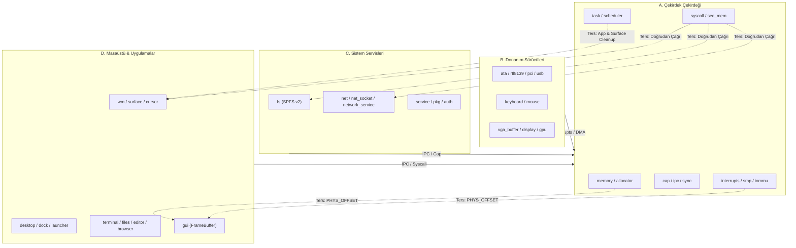

# Modül Bağımlılık Haritası ve Mimari Sınırlar (Faz 1.1)

**Tarih:** 2026-10-13  
**Kapsam:** SparkOS Mikroçekirdek modül bağımlılık analizi ve ters bağımlılık envanteri

---

## 1. Modül Grupları

| Grup | Rol | Modüller |
|---|---|---|
| **A. Çekirdek Çekirdeği (Core Kernel)** | Temel mikroçekirdek altyapısı: bellek, zamanlayıcı, capability, IPC, senkronizasyon, kesmeler, donanım soyutlama (HAL) | `memory`, `frame_pool`, `allocator`, `interrupts`, `gdt`, `task/*` (`process`, `simple_executor`, `yield_now`, `keyboard`, `mod`), `cap`, `ipc`, `sync`, `syscall`, `syscall_cap`, `syscall_storage`, `smp`, `acpi`, `iommu`, `dma_region`, `klog`, `panic`, `ktrace`, `serial`, `perf`, `perf_histogram`, `irq_mutex`, `sec_mem`, `elf`, `user`, `fd` |
| **B. Donanım Sürücüleri (Drivers)** | Donanım aygıt kontrolcüleri (İleride kullanıcı alanı servisleri) | `ata`, `rtl8139`, `usb`, `pci`, `gpu`, `gpu_virtio`, `keyboard`, `mouse`, `vga_buffer`, `display` |
| **C. Sistem Servisleri (Services)** | Dosya sistemi, ağ yığını, paket yönetimi, güvenlik ve kimlik (İleride Ring 3 servisleri) | `fs`, `net`, `net_socket`, `network_service`, `network_manager`, `pkg`, `pkg_service`, `store_service`, `service`, `auth`, `security`, `permission`, `shell_service`, `shell`, `crash_reporter` |
| **D. Masaüstü ve Kullanıcı Arayüzü (Desktop/UI)** | Pencere yöneticisi, grafik yüzeyleri, widget'lar ve yerleşik Ring-0 uygulamaları (İleride Ring 3 kullanıcı alanı) | `wm`, `desktop`, `dock`, `system_bar`, `cursor`, `damage`, `animation`, `theme`, `icons`, `surface`, `surface_raster`, `ui/*` (`apps`, `button`, `label`, `widget`, `mod`), `gui`, `input`, `event`, `clipboard`, `notification`, `launcher`, `app`, `app_manager`, `app_registry`, `browser_app`, `editor_app`, `editor`, `files_app`, `settings_app`, `taskmgr_app`, `terminal_app`, `sysmon_app`, `text`, `font`, `libspark_ui`, `lib_userspace`, `sysapi`, `regression` |

---

## 2. Mimari Bağımlılık Grafiği

---

## 3. A → B/C/D Ters Bağımlılıklar (Ters Yönlü Sızıntılar)

Mikroçekirdek mimarisinde Çekirdek Çekirdeği (A), sürücülere (B), servislere (C) veya masaüstü modüllerine (D) doğrudan bağımlı olmamalıdır. Aşağıdaki 28 adet ters bağımlılık tespit edilmiştir:

### 3.1 `gui::PHYS_OFFSET` Sızıntısı (7 adet A → D bağımlılığı)
- `acpi (A) -> gui (D)`
- `dma_region (A) -> gui (D)`
- `iommu (A) -> gui (D)`
- `memory (A) -> gui (D)`
- `sec_mem (A) -> gui (D)`
- `smp (A) -> gui (D)`
- `task/process (A) -> gui (D)`
*Kök Neden:* `PHYS_OFFSET` (fiziksel bellek doğrudan eşleme ofseti) değişkeni tarihsel olarak `src/gui.rs` içinde tanımlanmıştır. Tüm temel bellek yöneticileri bu ofseti okumak için `crate::gui`'ye başvurmaktadır.  
*Çözüm (Faz 2):* `PHYS_OFFSET` `src/memory.rs`'e taşındığında bu 7 ters bağımlılık anında ortadan kalkacaktır.

### 3.2 Syscall Katmanından Servis ve GUI'ye Doğrudan Çağrılar (8 adet A → B/C/D bağımlılığı)
- `syscall (A) -> input (D)` (sys_read_event)
- `syscall (A) -> surface (D)` (sys_surface_create / destroy)
- `syscall (A) -> wm (D)` (sys_wm_window_create vb.)
- `syscall (A) -> net_socket (C)` (sys_connect / send / recv)
- `syscall (A) -> rtl8139 (B)` (sys_net_send / recv)
- `syscall (A) -> vga_buffer (B)` (sys_write fallback)
- `syscall_storage (A) -> fs (C)` (dosya I/O syscall'ları)
- `fd (A) -> fs (C)` (FD tablo yönetimi VFS File nesnesi)
*Kök Neden:* Mikroçekirdek henüz mesaj tabanlı IPC ile servis çağırmak yerine, monolitik çekirdek gibi doğrudan fonksiyon çağrısı yapmaktadır.  
*Çözüm (Faz 4 & 5):* Bu syscall'lar Ring-3 servis IPC kanallarına yönlendirilecek veya `CapChannel` ile çözülecektir.

### 3.3 Süreç Yöneticisi ve Zamanlayıcıdan GUI/Uygulama Temizliği (7 adet A → B/D bağımlılığı)
- `task/process (A) -> files_app (D)`
- `task/process (A) -> terminal_app (D)`
- `task/process (A) -> surface (D)` (süreç öldüğünde yüzey iadesi)
- `task/process (A) -> wm (D)` (süreç pencerelerinin kapatılması)
- `task/process (A) -> input (D)` (input queue iadesi)
- `task/process (A) -> pci (B)` (cihaz yetki temizliği)
*Kök Neden:* Süreç sonlandığında (reap / exit) kullanıcı alanı kaynaklarını serbest bırakma mantığı `process.rs` içinde gömülüdür.  
*Çözüm (Faz 3 & 5):* Süreç sonlanması bir notification eventi olarak Ring 3 WM/Desktop servisine gönderilecek, kaynakları servis temizleyecektir.

### 3.4 Donanım ve Kesme Entegrasyonları (6 adet A → B/D bağımlılığı)
- `interrupts (A) -> mouse (B)` (IRQ 12 fare paketi alma)
- `iommu (A) -> pci (B)` (PCI aygıt tarama)
- `klog (A) -> vga_buffer (B)` (konsola log basma)
- `task/keyboard (A) -> keyboard (B)`
- `task/keyboard (A) -> input (D)`
- `task/keyboard (A) -> vga_buffer (B)`
- `perf (A) -> wm (D)` (`COMPOSITED_PIXELS` / `COMPOSITED_WINDOWS` telemetri okuması)
*Kök Neden:* Kesme işleyicileri ve klavye executor task'ı doğrudan sürücülere kilitlenmiştir.

---

## 4. Faz 1 Kapsamında İzlenecek Strateji
1. **Mekanik Ayırma:** `spark-abi` crate'i açılarak `CapHandle`, `Rights`, `SYS_*` sabitleri ortak no_std crate'e taşınacaktır.
2. **Workspace Bölünmesi:** Kök dizin workspace yapılacak, çekirdek `kernel/` dizinine taşınacaktır.
3. **Feature Gating:** D grubu modüller `#[cfg(feature = "legacy-desktop")]` arkasına alınacaktır. Yukarıda listelenen A → D ters bağımlılıkları `cfg` blokları veya stub kancaları ile sarılacaktır.
4. **İhlal Takibi:** Bu belgedeki 28 ters bağımlılık `docs/ALLOWED_VIOLATIONS.md` dosyasına kaydedilerek CI testine bağlanacaktır.
